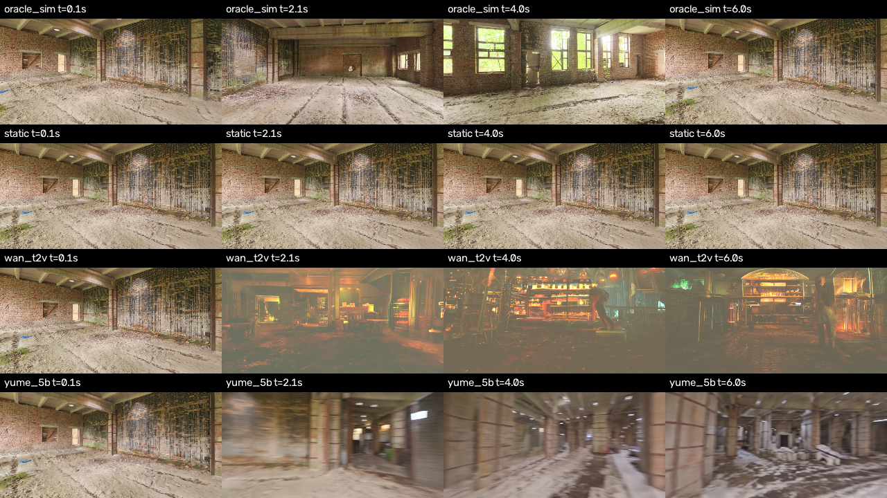

# WorldLoop

**A closed-loop, simulator-grounded benchmark for interactive world models.**

Most world-model evaluations score a *video*: they feed a trajectory, render the
result, and compare it with a reference clip. That answers "is this a good video?",
not "is this a world?". WorldLoop asks the three questions that separate a world
model from a video generator:

1. **Does the world change because of my action?** (counterfactual sensitivity)
2. **Does it stay changed while I am not looking?** (state persistence)
3. **Is it the same world when I come back?** (revisit / loop closure)

It is *closed loop* — every generated frame is fed back as the next condition,
exactly how these models are used — and *simulator-grounded*: cases are built on
photo-real 360° panoramas, so the camera trajectory, the occlusion schedule and the
ground-truth optical flow are analytic, not annotated.

```
panorama (CC0)  ──►  start frame + pose script  ──►  model plays the script
      │                                              (frame → action → frame …)
      └────────────────►  analytic GT flow  ◄──────  scores
```

## Why

The 2026 survey of 130 world-model benchmarks
([world-model-benchmarks.github.io](https://world-model-benchmarks.github.io/))
counts 74 control-oriented benchmarks; only 6 of them close the loop, and none of
them tests returning to a previously visited state. Yet "walk away, come back, and
the room is still the room" is the cheapest behavioural test of a world model
there is — and the one that fails first in practice.

## Protocols

| Protocol | Script | Duration | Question |
|---|---|---|---|
| `loop360` | 3 × `turn_right` 2 s (60°/s) | 6 s | Does the world survive a full turn? |
| `occlusion` | `turn_right` 2 s → `noop` 2 s → `turn_left` 2 s | 6 s | Do objects survive being off-screen for 4 s? |
| `null_action` | `noop` 4 s | 4 s | Does a world at rest stay at rest? |
| `drift` | `turn_right` 18 s | 18 s | How fast does it fall apart? |
| `counterfactual` | `noop` 2 s → left / right / `noop` 2 s → return 2 s | 6 s | Does the branch actually depend on the action? |

Metrics per protocol: analytic-flow agreement (`flow_cos`, `flow_mag_ratio`,
`axis_purity`, `switch_latency_frames`), revisit consistency (`revisit_dino`,
`revisit_ssim`, `revisit_lpips`), probe permanence (`permanence_dino`), stability
and drift (`null_motion_px`, `drift_slope_per_s`), plus two counterfactual
measurements over the action triplets: `cf_action_sep` (how far the left/right
branches move away from the no-op branch) and `cf_null_drift` (how far the no-op
branch wanders from itself). The three memory similarities are also reported
relative to a negative-pair floor (`*_norm`), because a raw SSIM/DINO similarity is
partly a statement about how smooth the imagery is; that floor-relative value is what
gets scored. Latency, realtime factor and peak VRAM are measured on the same GPU for
every model. Every case also carries a `frame_integrity` block, so a broken exporter
shows up as a metric instead of as a flattering score.

## Quick start

```bash
pip install -e .
python scripts/fetch_panos.py --out data/panos --n 10     # CC0 panoramas
python -m worldloop.cli gen-cases --n-panos 6 --out cases \
    --protocols loop360 occlusion null_action --cf-scenes 2

# calibration: the analytic renderer is the upper bound of the benchmark
python -m worldloop.cli run   --model oracle --cases cases/cases.json --out results/oracle_sim
python -m worldloop.cli score --results results/oracle_sim --cases cases/cases.json

# a real model (--model: oracle | static | yume | wan | matrix_game_3_5)
python -m worldloop.cli run   --model yume --cases cases/cases.json --out results/yume_5b
python -m worldloop.cli score --results results/yume_5b --cases cases/cases.json
python -m worldloop.cli report --results results/oracle_sim results/yume_5b \
    --out docs/RESULTS_leaderboard.md
```

## Adding a model

Any model with a `step(action) -> frames` loop can be evaluated:

```python
from worldloop.adapters.base import ClosedLoopModel

class MyModel(ClosedLoopModel):
    name = "my_model"
    native_fps = 16.0
    min_chunk_seconds = 2.0

    def reset(self, image, prompt="", seed=0): ...
    def step(self, action, seconds): ...   # returns BGR frames at native_fps
```

Chunk size stays inside the adapter, so a 0.5 s-chunk streaming model and a 4 s-chunk
offline model are compared on the same timeline. See `docs/PROTOCOL.md` for the full
spec and `worldloop/adapters/` for reference implementations (`oracle` analytic
renderer, `static` frozen baseline, `yume` keyboard-driven world model,
`matrix_game_space` trajectory-conditioned Space adapter, and `wan_t2v` negative
control).

## Results

See [`docs/RESULTS.md`](docs/RESULTS.md) for the full table and analysis, and
[`docs/PORTFOLIO_zh.md`](docs/PORTFOLIO_zh.md) for a Chinese write-up.

The figure below is the same `loop360` case played by four systems: four frames out
of a 6 s, 360° turn. A world model has to end where it started — the analytic
renderer does (`revisit_ssim = 0.99`), the 5 B interactive model does not, the
text-to-video model leaves the scene entirely, and the frozen baseline never moves.



Headline numbers (4 systems, 1× RTX 5060 Ti 16 GB; 25 cases for the non-learned
baselines, 19 for the interactive model, 12 for the control). `±` is the bootstrap
standard deviation over cases within each protocol (2 000 draws):

| model | n | Control | Memory | Stability | Causality | **World Score** |
|---|---|---|---|---|---|---|
| `oracle_sim` (analytic) | 25 | 95.8 ± 0.2 | 98.7 | 94.1 | 100 | **97.2 ± 0.1** |
| `static` (frozen frame) | 25 | 5.7 ± 1.1 | 98.7 | 99.9 | 0.0 | **23.7 ± 2.2** |
| `yume_5b` (interactive WM) | 19 | 78.0 ± 3.5 | 5.1 | 0.0 | 26.8 | **20.0 ± 3.2** |
| `wan2.1_t2v_1.3b` (no actions) | 12 | 27.5 ± 3.1 | 3.9 | 76.1 | 0.0 | **10.3 ± 2.0** |

- an interactive model follows the *direction* of a command well (0.97) and gets the
  *gain* wrong by scene — 0.70–1.33 of the commanded rate, i.e. one scene integrates
  559° of yaw for a commanded 360°. Direction and gain must be scored separately;
- one 360° turn is enough to lose the world: revisit SSIM 0.40 / DINO 0.35 vs
  0.99 / 1.00 for the analytic renderer, and a 4 s look-away is even worse
  (permanence 0.19). Measured against the *no-revisit* floor — the same instrument on
  views 120°+ away from the start — Yume's revisit similarity is 0.35 against a 0.350
  floor and its permanence 0.19 against 0.190: **it is no more similar to where it
  started than to any other direction**. That is why its Memory is 5, not 31;
- told to hold the camera still, the same model still moves the image
  **25.6 px/frame** (oracle: 0.02, i.e. RAFT noise) and integrates up to +94° of yaw
  while commanded to 0° — it cannot represent "no change";
- causality is the cleanest separator, once it is not a distance *ratio*: over
  counterfactual triplets the action branches separate from the no-op branch by
  0.21 (oracle 0.26, text-to-video model exactly 0.000 — its branches are
  byte-identical) while the no-op branch itself drifts 0.54 (oracle 0.00,
  video model 0.96). Scored as a product because either half alone can be gamed;
- the frozen frame wins Memory outright and loses Control outright, so on the
  geometric-mean World Score it now **edges out** the 5 B model (23.7 vs 20.0): a
  model that turns but keeps nothing is not better than a model that keeps
  everything and turns nothing. The world score is not a leaderboard of usefulness —
  it is a product of two capacities, and this one is missing one of them;
- `frame_integrity` is part of every case: the v0.1 run of the interactive model was
  withdrawn after four independently generated episodes were found to share a
  byte-identical frame at a chunk boundary. The bug was *flattering* (frozen frames
  score well on fidelity), which is why it is now a metric and a `score` warning
  instead of a footnote.

## Repository layout

```
worldloop/
  pano.py          equirect → perspective rendering + analytic GT flow
  actions.py       chunk-level action language → per-frame pose timeline
  cases.py         protocol definitions and case construction
  runner.py        closed-loop rollout
  metrics/         flow, DINOv2 features, revisit, permanence, counterfactual sep/drift
  adapters/        oracle, static, yume (keyboard WM), matrix_game_space (pose), wan_t2v
  report.py        leaderboard generation
docs/PROTOCOL.md   the evaluation spec
docs/DATASET.md    case-set card
docs/RESULTS.md    v0.2 analysis (raw table in docs/RESULTS_leaderboard.md)
```

## Limitations

Rotation-only camera motion (no translation ⇒ no physics/contact evaluation), 720p
at 8 fps, one panorama per case, probes are image regions rather than segmented
object instances. Coverage is 19 of 25 cases for the interactive model and 12 of 25
for the control (both at 15/15 on the held-out set), so the numbers are a protocol
demonstration, not an authoritative ranking. The memory floor is measured on each
model's own frames, so it separates "no memory" from "no world consistency" only
approximately. Details and rationale in `docs/PROTOCOL.md` §7.

## License

Code: Apache-2.0. Panoramas: CC0 (Poly Haven).
