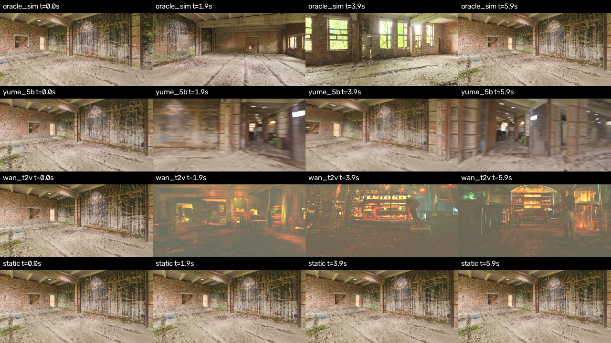

# WorldLoop v0.1 — results

Run date 2026-11-13/14 · one RTX 5060 Ti (16 GB, sm_120) · 1280×720, 8 fps timeline · 25 cases

Four systems were evaluated with the same harness. Two are real models, two are
calibration instruments.

| system | kind | params | where | coverage |
|---|---|---|---|---|
| `oracle_sim` | analytic panorama renderer | — | CPU | 25 cases (all) |
| `static` | degenerate (freezes frame 0) | 0 | CPU | 25 cases (all) |
| `wan2.1_t2v_1.3b` | text-to-video, **no action input** | 1.3 B | local 16 GB | 12 cases (3 scenes × 3 protocols + counterfactual) |
| `yume_5b` | interactive world model | 5 B | local 16 GB | 15 cases (4 scenes × 3 protocols + counterfactual) |

## Leaderboard

| model | Control | Memory | Stability | Causality | **World Score** |
|---|---|---|---|---|---|
| `oracle_sim` | 99.9 | 99.2 | 94.1 | 97.1 | **99.6** |
| `yume_5b` | 81.4 | 34.9 | 0.0 | 92.5 | **53.3** |
| `wan2.1_t2v_1.3b` | 27.5 | 26.1 | 74.5 | 0.0 | **26.8** |
| `static` | 5.7 | 99.2 | 99.9 | 0.0 | **23.8** |

`World Score = sqrt(Control × Memory)` — a world model has to both move when told
and keep the world it moved through. The geometric mean is what stops the two
degenerate solutions: doing nothing (Control 0) and re-inventing the scene every
chunk (Memory ~0).

### Raw numbers

| model | flow_cos | flow_mag | revisit DINO | revisit SSIM | permanence | drift/s | null motion px | **ASR** |
|---|---|---|---|---|---|---|---|---|
| `oracle_sim` | 0.998 | 1.00 | 1.000 | 0.989 | 0.988 | −0.006 | 0.023 | 100 |
| `static` | 0.057 | 0.00 | 1.000 | 0.989 | 0.988 | 0.000 | 0.023 | 0.000 |
| `wan2.1_t2v_1.3b` | 0.143 | 0.026 | 0.144 | 0.443 | 0.195 | 0.017 | 1.37 | **0.000** |
| `yume_5b` | 0.631 | 0.690 | 0.331 | 0.460 | 0.254 | 0.073 | **11.78** | **37.10** |

| model | s per 2 s chunk | realtime factor | peak VRAM |
|---|---|---|---|
| `oracle_sim` | 2.3 | 1.37× | — |
| `static` | 0.007 | 417× | — |
| `wan2.1_t2v_1.3b` | 91.5 | 0.027× | 4.7 GB |
| `yume_5b` | 691 | 0.008× | ~15 GB (process) |

Per-protocol detail is in [`RESULTS_leaderboard.md`](RESULTS_leaderboard.md).



*Same case, same start frame, four systems. Oracle returns to the start view.
Yume turns (and blurs) but ends in a different room. Wan leaves the building
entirely. Static never moves.*


*Feature drift against the conditioning frame during the 360° loop. The oracle's
U-shape is the signature of a persistent world: it drifts while facing away and
comes back to ~0. Yume has the same shape but never returns, and shows a step at
t = 2 s — a chunk boundary. Wan jumps to 0.86 in the first 0.5 s. Static is flat.*

## Findings

**F1 — Interactive models follow direction, not gain (H1 confirmed).**
Yume's direction agreement is 0.764 on the full loop and 0.497 on the look-away,
while its flow-magnitude ratio is 0.65–0.73: it turns the right way at roughly
two-thirds of the commanded 60°/s. Direction and gain have to be scored separately;
a single "action following" number would hide this.

**F2 — One 360° turn is enough to lose the world (H2 confirmed).**
Revisit SSIM 0.460 / DINO 0.331 (four scenes) against 0.989 / 1.000 for the
analytic renderer. The qualitative view agrees: after 6 s the model is in a
*plausible* interior that is not the one it started in.

**F3 — A 4 s look-away is worse than a full turn (H3 confirmed).**
Permanence 0.254 versus revisit DINO 0.331: objects that leave the frame for 4 s
come back less faithfully than the whole scene does after 6 s of motion. Object
permanence does not degrade gracefully — it collapses as soon as the content is out
of view.

**F4 — The model cannot stand still (new, not hypothesised).**
Under `null_action` Yume produces **11.78 px/frame** of image motion (oracle: 0.023,
i.e. RAFT noise; Wan: 1.37). Told to hold the camera, it keeps panning. A world
model that cannot represent "no change" cannot be used as an environment for a
policy: the policy's own no-op becomes an action.

**F5 — Causality is the cleanest separator (H4 confirmed).**
Counterfactual triplets (same start frame and seed: turn left / turn right /
no-op) give **ASR = 37.1** for Yume with a pre-divergence distance of 0.002 — the
branches are *deterministic* before the intervention and diverge strongly after it.
Wan gives **ASR = 0.000**: its branches are byte-identical, which is exactly what
"no action input" means. This is the number that answers "is this a world model or
a video generator" without any reference video.

**F6 — The negative control behaves exactly as designed (H5 confirmed).**
Wan2.1-T2V has no action input: direction agreement 0.069–0.216 (noise floor),
magnitude ratio 0.026, and it replaces the scene wholesale (revisit DINO 0.144).
Its Stability score is nevertheless 74.5 — a still-ish video is "stable" — which is
precisely why the World Score is a geometric mean and not an average.

**F7 — The degenerate baseline is the honest test of the metric.**
`static` scores 99.2 on Memory and 99.9 on Stability by never moving. It gets
World Score 23.8, below both real models. Any consistency benchmark without a
control axis can be won by a frozen frame; this one cannot.

**F8 — Cost is the quiet constraint.**
Yume needs **691 s to generate 2 s of video** (0.008× realtime, ~120× slower than
real time) on a 16 GB consumer card at 544×960 / 4 sampling steps, including a
~150 s weight load per case. The "runs on a 16 GB GPU" claim is about *fitting*, not
about being interactive. Wan is ~7× faster and still ~37× slower than realtime.

## Calibration

The oracle is the analytic renderer of the same panorama; it is the ceiling every
metric must be able to reach, and it does: `flow_cos` 0.998, `revisit_ssim` 0.989,
`permanence` 0.988, `null_motion` 0.023 px, World Score 99.6. Reaching exactly 100
is impossible by construction (RAFT noise on identical frames, JPEG rounding),
which is why the group scores are absolute rather than oracle ratios.

## Threats to validity

1. **Sampling settings.** Yume ran at 544×960 / 4 steps for time, not at its best
   quality; absolute numbers are a lower bound on the model. The *pattern*
   (direction ✓, persistence ✗, null action ✗) is not a sampling artifact — all
   three appear in the qualitative frames as well.
2. **Coverage.** 4 scenes for Yume, 3 for Wan. This is a protocol demonstration,
   not a leaderboard; every number carries its `n_cases`.
3. **The negative control is not the official Wan2.1.** The text encoder is a local
   fp8→bf16 conversion of a umT5-XXL fine-tune, not the official fp32 encoder (the
   download would not fit the time budget). DiT and VAE are official. This affects
   the *quality* of Wan's video, not the fact that it ignores actions (verified:
   the same seed and prompt produce byte-identical frames for different actions,
   hence ASR = 0.000).
4. **Action gain is not calibrated per model.** The 60°/s command is mapped to each
   model's native interface without tuning; `flow_mag_ratio` exists to expose that
   mismatch rather than hide it.
5. **RAFT on generated video** is noisy; pixels with |GT| < 1.5 px are masked, the
   magnitude ratio uses a median, and direction agreement is magnitude-weighted and
   computed per segment (a protocol that turns right then left would otherwise
   cancel itself out).
6. **ASR is a ratio.** A perfectly deterministic model can drive the denominator to
   ~0, so the raw pre/post distances are reported alongside it.

## Not evaluated, and why

| model | blocker |
|---|---|
| Matrix-Game 3.5 (5 B) | ≥40 GB locally; its official HF Space refuses anonymous ZeroGPU (min request 278 s vs 120 s/day anonymous quota) — adapter written and geometry-validated offline, needs an HF PRO token |
| Matrix-Game 3.0 (5 B) | 24 GB + FlashAttention-3, A100/H100 only per the authors |
| Matrix-Game 4.0 | 16 GB preset exists but Linux + CUDA 13.2 only; different paradigm (engine-fed low-poly stream) |
| HY-WorldPlay (8 B) | 28 GB at `sp=8`, 72 GB at `sp=1` |
| LingBot-World (A14B) | 8-GPU FSDP launch scripts only |
| ABot-World-0 (5 B) | 19 GB measured on RTX 5090 + heavy kernel build chain |
| Cosmos 3 Nano (16 B) | positioned for RTX Pro 6000 / H100 |
| Genie 3 | closed weights |

## Reproduce

```bash
python scripts/fetch_panos.py --out data/panos --n 10
python -m worldloop.cli gen-cases --n-panos 6 --out cases
python -m worldloop.cli run   --model oracle --out results/oracle_sim
python -m worldloop.cli run   --model static --out results/static
python -m worldloop.cli run   --model wan  --panos abandoned_bakery,empty_warehouse_01,studio_small_03 \
    --steps 6 --out results/wan_t2v
python -m worldloop.cli run   --model wan  --cases-filter abandoned_bakery__cf --steps 6 --out results/wan_t2v
python -m worldloop.cli run   --model yume --panos abandoned_bakery,empty_warehouse_01,studio_small_03,brown_photostudio_02 \
    --steps 4 --resolution 544x960 --model-python .venv_yume/Scripts/python.exe --out results/yume_5b
python -m worldloop.cli run   --model yume --cases-filter abandoned_bakery__cf \
    --steps 4 --resolution 544x960 --model-python .venv_yume/Scripts/python.exe --out results/yume_5b
python -m worldloop.cli score --results results/yume_5b
python -m worldloop.cli report --results results/oracle_sim results/static results/wan_t2v results/yume_5b \
    --out docs/RESULTS_leaderboard.md
```
