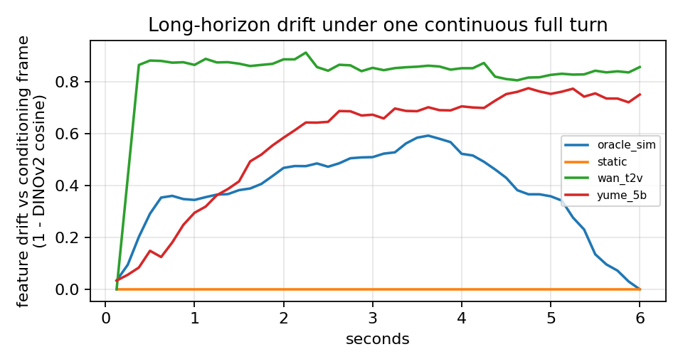
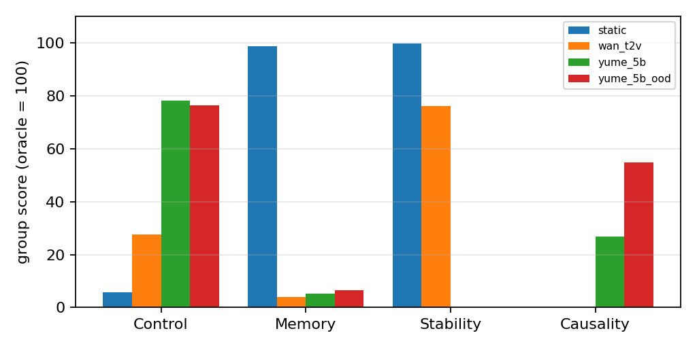

# WorldLoop v0.2 — results

Run date 2026-11-13 (control baselines) / 2026-11-25–26 (interactive models) · one
RTX 5060 Ti (16 GB, sm_120) · 1280×720, 8 fps timeline · 25 in-distribution + 15
out-of-distribution cases

Four systems were evaluated with the same harness on the in-distribution set, and all
of them again on the held-out set. Two are real models, two are calibration
instruments. Every row states its own `n`; nothing is averaged across models with
different coverage.

| system | kind | params | where | in-dist coverage | OOD coverage |
|---|---|---|---|---|---|
| `oracle_sim` / `oracle_sim_ood` | analytic panorama renderer | — | CPU | 25 / 25 | 15 / 15 |
| `static` / `static_ood` | degenerate (freezes frame 0) | 0 | CPU | 25 / 25 | 15 / 15 |
| `wan2.1_t2v_1.3b` | text-to-video, **no action input** | 1.3 B | local 16 GB | 12 / 12 (4 scenes × 3 protocols; counterfactual on 1 group) | not run |
| `yume_5b` / `yume_5b_ood` | interactive world model | 5 B | local 16 GB | 19 / 25 (4 scenes × 3 protocols + drift + counterfactual on 2 groups) | 15 / 15 |

## Leaderboard

In-distribution (`±` is the bootstrap standard deviation, 2 000 draws resampling cases
within each protocol; the 95 % interval is roughly `±1.96×` that — see *Uncertainty*
below):

| model | n | Control | Memory | Stability | Causality | **World Score** |
|---|---|---|---|---|---|---|
| `oracle_sim` | 25 | 95.8 ± 0.2 | 98.7 ± 0.1 | 94.1 ± 2.6 | 100 | **97.2 ± 0.1** |
| `static` | 25 | 5.7 ± 1.1 | 98.7 ± 0.1 | 99.9 ± 0.0 | 0.0 | **23.7 ± 2.2** |
| `yume_5b` | 19 | 78.0 ± 3.5 | 5.1 ± 1.6 | 0.0 | 26.8 | **20.0 ± 3.2** |
| `wan2.1_t2v_1.3b` | 12 | 27.5 ± 3.1 | 3.9 ± 1.2 | 76.1 ± 10.3 | 0.0 | **10.3 ± 2.0** |

Out-of-distribution, on four held-out panoramas (a hotel room, the Lebombo mountains,
Venice at sunset, city rooftops). No `drift` case, so the Static Control floor is not
comparable to the table above (see *Calibration*):

| model | n | Control | Memory | Stability | Causality | **World Score** |
|---|---|---|---|---|---|---|
| `oracle_sim_ood` | 15 | 95.8 ± 0.9 | 98.0 ± 0.3 | 92.3 ± 6.1 | 100 | **96.9 ± 0.5** |
| `static_ood` | 15 | 13.5 ± 0.6 | 98.0 ± 0.3 | 99.8 ± 0.0 | 0.0 | **36.3 ± 0.8** |
| `yume_5b_ood` | 15 | 76.4 ± 3.6 | 6.6 ± 1.9 | 0.0 | 54.7 | **22.5 ± 3.3** |

`World Score = sqrt(Control × Memory)` — a world model has to both move when told
and keep the world it moved through. The geometric mean is what stops the two
degenerate solutions: doing nothing (Control 0) and re-inventing the scene every
chunk (Memory ~0). The 5 B model loses one of those capacities outright, which is why
it sits below the frozen frame here (20.0 vs 23.7). That ordering is not a joke about
usefulness — the frozen frame is obviously useless as an environment — it is the score
saying that *turning while keeping nothing* is a failure of the same magnitude as
*keeping everything while turning nothing*, and that the product is the wrong place to
look for a subtler ranking.

### Raw numbers

Memory similarities are reported three ways: the raw value, the negative-pair floor it
was measured against, and the floor-relative value that is actually scored. The floor
is the same DINO/SSIM instrument applied to pairs that are definitely not revisits
(reference vs frames whose *commanded* camera is 120°+ away; for permanence, probe A's
reference patch vs probe B's projected direction).

| model | flow_cos | flow_mag | axis purity | switch lat. (f) | revisit DINO | DINO floor | DINO norm | revisit SSIM | SSIM floor | SSIM norm | permanence | perm. floor | perm. norm | drift/s | null motion px | CF sep | CF drift | ASR (legacy) |
|---|---|---|---|---|---|---|---|---|---|---|---|---|---|---|---|---|---|---|
| `oracle_sim` | 0.998 | 0.999 | 1.000 | 1.00 | 1.000 | 0.572 | 0.999 | 0.989 | 0.345 | 0.982 | 0.988 | 0.359 | 0.980 | −0.006 | 0.023 | 0.263 | 0.000 | 100 |
| `static` | 0.057 | 0.000 | — | — | 1.000 | 0.593 | 0.998 | 0.989 | 0.357 | 0.982 | 0.988 | 0.359 | 0.980 | −0.000 | 0.023 | 0.000 | 0.000 | 0.000 |
| `yume_5b` | 0.969 | 0.843 | 0.997 | 5.00 | 0.352 | **0.350** | 0.066 | 0.400 | 0.363 | 0.070 | 0.191 | **0.190** | 0.018 | 0.076 | **25.60** | 0.212 | 0.540 | 99.8 |
| `wan2.1_t2v_1.3b` | 0.143 | 0.026 | 0.408 | — | 0.144 | 0.203 | 0.029 | 0.443 | 0.403 | 0.070 | 0.195 | 0.203 | 0.017 | 0.017 | 1.12 | **0.000** | **0.957** | 0.000 |
| `oracle_sim_ood` | 1.000 | 0.999 | 1.000 | 1.00 | 0.999 | 0.432 | 0.999 | 0.989 | 0.532 | 0.974 | 0.981 | 0.364 | 0.967 | −0.008 | 0.026 | 0.483 | 0.000 | 100 |
| `static_ood` | 0.135 | 0.000 | — | — | 0.999 | 0.482 | 0.999 | 0.989 | 0.528 | 0.974 | 0.981 | 0.364 | 0.967 | −0.000 | 0.026 | 0.000 | 0.000 | 0.000 |
| `yume_5b_ood` | 0.856 | 0.789 | 0.997 | 4.50 | 0.317 | 0.374 | 0.093 | 0.622 | **0.572** | 0.103 | 0.223 | 0.232 | 0.003 | 0.120 | 15.94 | 0.322 | 0.207 | 100 |

| model | s per 2 s chunk | realtime factor | peak VRAM |
|---|---|---|---|
| `oracle_sim` | 2.3 | 1.37× | — |
| `static` | 0.007 | 455× | — |
| `wan2.1_t2v_1.3b` | 96.9 | 0.027× | 4.9 GB |
| `yume_5b` | 190 | 0.011× | 13.6 GB (allocated) |
| `yume_5b_ood` | 197 | 0.011× | 13.6 GB (allocated) |

Per-protocol detail, the coverage table every number is derived from, and the
per-group counterfactual breakdown are in
[`RESULTS_leaderboard.md`](RESULTS_leaderboard.md) (regenerated by the report
command, byte-identical to a rerun).

## Uncertainty

Intervals are a 2 000-draw bootstrap that resamples cases *within each protocol*
(preserving each protocol's case count) and re-runs the aggregation, so they answer
"which of these two models would I still separate on a different draw of the same
four scenes". Two consequences worth stating instead of hiding:

- **Causality has no meaningful post-hoc interval.** The statistic is a mean over
  counterfactual *groups*, of which Yume has two in distribution and one OOD;
  resampling groups apart is not a replicate, so the bootstrap returns a degenerate
  interval. The per-group spread is the honest uncertainty and it is large: Yume's
  action separation is 0.356 on `abandoned_bakery` and 0.068 on
  `empty_warehouse_01`. Causality is reported as a point estimate with that caveat,
  not with a `±`.
- **Yume's Control interval is wide (78.0 ± 3.5)** because its four loop360 scenes
  disagree substantially (`flow_mag` 0.70–1.33, see F1). The aggregate is real but
  it is an average over a scene-dependent behaviour.

## Figures


*Same case, same start frame, four systems. Oracle returns to the start view. Yume
turns smoothly and plausibly but ends in a different room. Wan abandons the scene
entirely after the first chunk. Static never moves.*



*Feature drift against the conditioning frame during the 360° loop. The oracle's
U-shape is the signature of a persistent world: it drifts while facing away and comes
back to ~0 at t = 6 s. Yume rises monotonically to ~0.75 and never comes back. Wan
jumps to 0.86 within 0.5 s. Static is flat.*



*Group scores. The picture the table cannot show: Yume and Wan sit at the bottom of
Memory alongside the frozen baseline's Control.*

## Findings

**F1 — Interactive models follow direction, and get the gain wrong (H1 refined).**
With a working exporter, Yume's direction agreement is **0.969** overall (0.995 on
the full loop, 0.915 on the look-away): it turns the right way. The *gain* is
scene-dependent — flow-magnitude ratio 0.70 / 0.80 / 0.90 / **1.33** across four
scenes, and the integrated yaw for a commanded 360° loop is 298° / 271° / 398° /
**559°**. One scene over-rotates by 1.55×: the model looks like it is obeying, and
still walks the world twice as far as it was told. Direction and gain have to be
scored separately; a single "action following" number would have hidden this.

**F2 — One 360° turn is enough to lose the world (H2 confirmed).**
Revisit SSIM 0.400 / DINO 0.352 against 0.989 / 1.000 for the analytic renderer, and
the qualitative view agrees: after 6 s the model is in a *plausible* interior that is
not the one it started in. The aggregate carries ± because the failure is not
uniform: per-scene revisit DINO ranges 0.058 (brown_photostudio_02) to 0.324.

**F3 — The raw memory numbers were measuring smoothness, not memory (metric
redesigned).** Revisit similarity has a data-dependent floor: smooth, low-texture
imagery is similar to everything. Measured against the model's *own* non-revisit
pairs — the start view against frames the camera was commanded 120°+ away from it —
Yume's revisit DINO is 0.352 against a **0.350** floor, its revisit SSIM 0.400
against 0.363, and its object permanence 0.191 against **0.190**. In other words its
"revisit" frame is exactly as similar to the start view as a random other direction
is: the raw numbers were reporting the statistics of its imagery, not its memory,
which is why Memory was 31.4 before the floor was subtracted and is **5.1** now.
This is the same class of defect as the retired ASR: a similarity whose denominator
(or baseline) moves with the data, averaged as if it were absolute.

**F4 — A 4 s look-away is worse than a full turn (H3 confirmed, and now
interpretable).** Floor-relative, permanence 0.018 versus revisit DINO 0.066: objects
that leave the frame for 4 s come back less faithfully than the whole scene does after
6 s of motion. Object permanence does not degrade gracefully — it is gone as soon as
the content is out of view.

**F5 — The model cannot stand still (new, not hypothesised).**
Under `null_action` Yume produces **25.6 px/frame** of image motion (oracle: 0.023 —
i.e. RAFT noise on identical frames; Wan: 1.12). Told to hold the camera, it pans by
10.5 / 37.5 / 34.8 / 19.6 px/frame per scene and integrates up to **+93.9°** of yaw
while commanded to 0°. A world model that cannot represent "no change" cannot be used
as an environment for a policy: the policy's own no-op becomes an action. This is now
measured on ten independent episodes, not one.

**F6 — Causality separates world models from video generators, once the metric is
not a ratio (H4 confirmed, metric redesigned).**
Counterfactual triplets (same start frame and seed: turn left / turn right / no-op)
are scored on two DINOv2 quantities. Action separation (does the branch depend on the
action?) is 0.263 for the oracle, 0.212 for Yume, **0.000** for Wan — whose branches
are byte-identical, which is exactly what "no action input" means. The second
quantity, no-op drift (is the control branch actually a control?), is 0.000 / 0.540 /
**0.957**. The product of the two, `100 · clip01(sep/0.25) · 1/(1 + drift/0.25)`,
gives 100 / 26.8 / 0. It is the only axis that needs no reference video, and it is
the only one where a frozen frame and a scene-replacing generator both score 0
instead of one of them scoring well.

The old `ASR` (post/pre distance ratio, capped at 100) is retained for audit only.
Its denominator is legitimately 0 for a deterministic renderer, so the oracle itself
saturated at the cap and was indistinguishable from a Yume run that scored 95 on the
same axis. That number is in the raw table as `ASR (legacy)` and does not enter any
group score.

**F7 — The negative control behaves exactly as designed (H5 confirmed).**
Wan2.1-T2V has no action input: direction agreement 0.143 (noise floor), magnitude
ratio 0.026, and it replaces the scene wholesale (revisit DINO 0.144, floor-relative
0.029). Its Stability score is nevertheless 76.1 — a still-ish video is "stable" —
which is precisely why the World Score is a geometric mean and not an average, and
why Stability alone cannot be a headline.

**F8 — The degenerate baseline is the honest test of the metric.**
`static` scores 98.7 on Memory and 99.9 on Stability by never moving. It gets World
Score 23.7 — **above** the interactive model — while its Control is 5.7 and its
Causality is 0 by construction. Any consistency benchmark without a control axis can
be won by a frozen frame; this one cannot, but the product also cannot rank a
one-armed model against another one-armed model. The rows above should be read as four
independent capacities, not as a single ordering.

**F9 — Cost is the quiet constraint.**
Yume needs **190 s to generate 2 s of video** (0.011× realtime, ~90× slower than real
time) on a 16 GB consumer card at 544×960 / 4 sampling steps; a full 18 s drift
episode took 1 889 s. The "runs on a 16 GB GPU" claim is about *fitting*, not about
being interactive. Wan is ~2× faster per chunk and still ~37× slower than realtime.

**F10 — An exporter bug can win a benchmark, and now it cannot hide.**
The first Yume run (2026-11-13) exported its frames through a buffer-reuse bug: every
episode froze for 7 frames at the first chunk boundary and then replayed its own
opening frames. The result was *flattering* — the frozen frames show a real,
well-lit render, so the fidelity metrics barely moved while the model looked calmer
than it was (null motion 11.8 px instead of 25.6). It was caught by hashing frames,
not by looking at a score: four independently generated cases contained a
byte-identical frame. Every case now carries a `frame_integrity` block
(`dup_frames`, `max_identical_run`, `rewound_frames`, `rewound_motion_deg`) and
`score` prints a warning when a non-frozen model repeats a frame while the commanded
camera is still moving. The v0.1 Yume numbers that appear in earlier notes are
withdrawn; the rows above are a clean 19-case re-run (and a separate 15-case OOD
re-run), both with `rewound_frames = 0` on every case.

## Calibration

The oracle is the analytic renderer of the same panorama; it is the ceiling every
metric must be able to reach, and it does: `flow_cos` 0.998, `revisit_ssim` 0.989,
`permanence` 0.988, `null_motion` 0.023 px, World Score **97.2**. Reaching exactly
100 is impossible by construction (RAFT noise on identical frames, JPEG rounding),
which is why the group scores are absolute rather than oracle ratios.

The OOD split is a *calibration*, not just a second leaderboard: it re-runs all
systems on four held-out panoramas. The oracle holds — World Score 96.9 against 97.2
in-distribution — losing a little Memory (permanence 0.967 vs 0.980 floor-relative)
and Stability (92.3 vs 94.1), the latter because the split has no `drift` episode
whose near-zero slope would pull the mean down. The static floor, by contrast, moves a
lot: Control 5.7 in-distribution versus **13.5** OOD. Two reasons, both structural —
the missing `drift` case removes a legitimate 0.0 from the indoor Control mean, and
outdoor/night panoramas give RAFT more spurious flow (static's occlusion `flow_cos`
is 0.171 indoors and 0.269 OOD). The consequence for reading the board: a difference
in Control below ~10 points between an in-distribution and an OOD number is not
evidence of anything.

The interactive model transfers without a visible OOD collapse, and the numbers say
something specific about *why* the OOD board looked better before the floor was
subtracted. Yume's OOD revisit SSIM is 0.622 versus 0.400 indoors — but its OOD floor
is **0.572** versus 0.363, so the floor-relative value is 0.103 versus 0.070, and
Memory goes 5.1 → 6.6 instead of 31.4 → 38.7. The apparent out-of-distribution
"improvement" was entirely the floor rising: outdoor and night panoramas are smoother
and lower-texture, so everything is more similar to everything. This is the clearest
illustration in the whole write-up of why a similarity needs a floor: the same model,
the same protocols, and an 18-point swing in Memory that reflects the *images*, not
the memory. A sanity check on the other axis: its OOD Causality (54.7) is higher than
indoors (26.8) because the single OOD counterfactual group (`hotel_room__cf`) has both
a larger action separation (0.322 vs 0.212) and a *lower* null drift (0.207 vs 0.540);
with n=1 group, that is a scene anecdote, not a trend.

## Threats to validity

1. **Sampling settings.** Yume ran at 544×960 / 4 steps for time, not at its best
   quality; absolute numbers are a lower bound on the model. The *pattern*
   (direction ✓, gain ✗, persistence ✗, null action ✗) is not a sampling artifact —
   all four appear in the qualitative frames as well.
2. **Coverage.** 19 of 25 cases for Yume (4 of 6 scenes, but both counterfactual
   groups), 12 of 25 for Wan (4 of 6 scenes, one counterfactual group), 15 of 15 OOD
   for both. This is a protocol demonstration, not a leaderboard; every row states
   its `n` and its bootstrap spread, and leaving a case out changes the aggregate
   (see F2's per-scene range).
3. **The negative control is not the official Wan2.1.** The text encoder is a local
   fp8→bf16 conversion of a umT5-XXL fine-tune, not the official fp32 encoder (the
   download would not fit the time budget). DiT and VAE are official. This affects
   the *quality* of Wan's video, not the fact that it ignores actions (verified: the
   same seed and prompt produce byte-identical branches for different actions).
4. **Action gain is not calibrated per model.** The 60°/s command is mapped to each
   model's native interface without tuning; `flow_mag_ratio` and the integrated yaw
   exist to expose that mismatch rather than hide it (F1).
5. **RAFT on generated video** is noisy; pixels with |GT| < 1.5 px are masked, the
   magnitude ratio uses a median, and direction agreement is magnitude-weighted and
   computed per segment (a protocol that turns right then left would otherwise cancel
   itself out).
6. **The counterfactual scale is a fixed constant.** `0.25` DINOv2 cosine is set from
   the measured distance between two *different* panoramas in this dataset (0.79 mean,
   15 scene pairs), so it is "a third of a scene change". It is a calibration, not a
   physical unit, and one scene pair in this dataset sits as low as 0.61.
7. **`switch_latency_frames` comes from one protocol only.** The counterfactual
   branches are the only ones whose action changes mid-episode, so the latency
   component of Control rests on their n, not on the full case count.
8. **The memory floor is model-dependent, which is both the point and a limit.** The
   floor is measured on the model's *own* frames at commanded angles 120°+ from the
   start, so a model that hallucinates a brand-new room the moment it turns outward
   gets a high floor and therefore a low normalized score. That is the intended
   reading — a world whose unseen parts share nothing with its start view cannot be
   remembered either — but it does conflate "no memory" with "no world consistency".
   For a model whose imagery never moves with the command (a frozen frame) the floor
   falls back to the panorama itself, rendered 180° from the start pose; that path
   credits the trivial memory the frozen baseline really has and leaves its failure on
   Control.
9. **Stale-image risk is real but now instrumented.** The v0.1 numbers were not
   reproducible from their own frames (F10). The defence is `frame_integrity` plus
   `--force`-free reruns that skip cases with an existing `meta.json`: a partial
   rerun silently mixes old and new rollouts, so the figures and the report must be
   regenerated from the same tree that produced the metrics.

## Not evaluated, and why

| model | blocker |
|---|---|
| Matrix-Game 3.5 (5 B) | ≥40 GB locally; its official HF Space refuses anonymous ZeroGPU (min request 278 s vs 120 s/day anonymous quota) — adapter written and geometry-validated offline, needs an HF PRO token |
| Matrix-Game 3.0 (5 B) | 24 GB + FlashAttention-3, A100/H100 only per the authors |
| Matrix-Game 4.0 | 16 GB preset exists but Linux + CUDA 13.2 only; different paradigm (engine-fed low-poly stream) |
| HY-WorldPlay (8 B) | 28 GB at `sp=8`, 72 GB at `sp=1` |
| LingBot-World (A14B) | 8-GPU FSDP launch scripts only |
| ABot-World-0 (5 B) | 19 GB measured on RTX 5090 + heavy kernel build chain |
| Cosmos 3 Nano (16 B) | positioned for RTX Pro 6000 / H100 |
| Genie 3 | closed weights |

## Reproduce

```bash
python scripts/fetch_panos.py --out data/panos --n 10
python -m worldloop.cli gen-cases --n-panos 6 --out cases
python -m worldloop.cli run   --model oracle --out results/oracle_sim
python -m worldloop.cli run   --model oracle --cases cases_ood/cases.json --out results/oracle_sim_ood
python -m worldloop.cli run   --model static --out results/static
python -m worldloop.cli run   --model static --cases cases_ood/cases.json --out results/static_ood
python -m worldloop.cli run   --model wan  --panos abandoned_bakery,empty_warehouse_01,studio_small_03 \
    --steps 6 --out results/wan_t2v
python -m worldloop.cli run   --model wan  --cases-filter abandoned_bakery__cf --steps 6 --out results/wan_t2v
python -m worldloop.cli run   --model yume --panos abandoned_bakery,empty_warehouse_01,studio_small_03,brown_photostudio_02 \
    --steps 4 --resolution 544x960 --model-python .venv_yume/Scripts/python.exe --out results/yume_5b
python -m worldloop.cli run   --model yume --cases-filter __cf \
    --steps 4 --resolution 544x960 --model-python .venv_yume/Scripts/python.exe --out results/yume_5b
python -m worldloop.cli run   --model yume --cases cases_ood/cases.json \
    --steps 4 --resolution 544x960 --model-python .venv_yume/Scripts/python.exe --out results/yume_5b_ood
python -m worldloop.cli score --results results/oracle_sim --cases cases/cases.json
python -m worldloop.cli score --results results/yume_5b   --cases cases/cases.json
python -m worldloop.cli report --results results/oracle_sim results/static results/wan_t2v results/yume_5b \
    results/oracle_sim_ood results/static_ood results/yume_5b_ood --out docs/RESULTS_leaderboard.md
python scripts/make_figures.py results/oracle_sim results/static results/wan_t2v results/yume_5b results/yume_5b_ood
```

Notes on the commands, all learned the hard way:
`run` skips a case whose `meta.json` already exists, so a re-run needs `--force` or a
clean output directory — and a partial re-run mixes rollouts from two exporters (F10).
`run --model yume` must be preceded by killing stray `yume_cli.py --serve` processes:
two 5 B servers do not fit in 16 GB and the failure surfaces as a CUDA access
violation, not as an out-of-memory error. The adapter now refuses to start below
14 GB of free VRAM and names the stray PIDs; `WORLDLOOP_MIN_FREE_VRAM_GB=0` disables
that check. `score` needs the GPU (DINOv2, RAFT, LPIPS) and must not run while a
generation job owns the card. `score` re-reads frames, so it is also the step that
would expose a stale `metrics.json`. The OOD run takes ~2.3 h at these settings; the
in-distribution one ~3.3 h.
